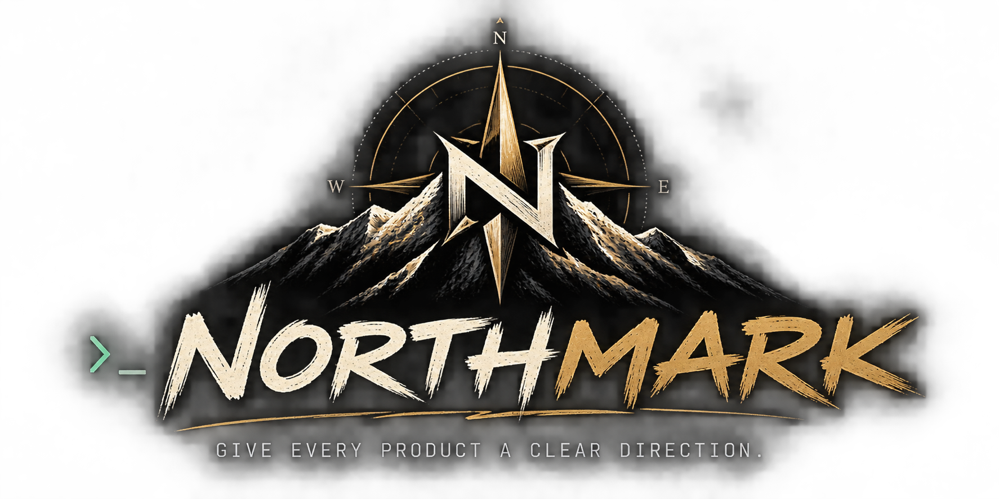

# Northmark

  

   

---

**Northmark — Give every product a clear direction.**

Northmark is a source-aware CLI that uses MH to turn your codebase into structured, actionable product documentation. From foundational READMEs and product briefs to design direction and architectural context, Northmark establishes a shared source of truth that keeps product vision, design, and development aligned as your project evolves.

## Features

- Source-aware CLI for structured product documentation
- Converts codebase into actionable product insights
- Supports foundational READMEs, product briefs, design direction, and architectural context
- Establishes a shared source of truth for product vision, design, and development alignment